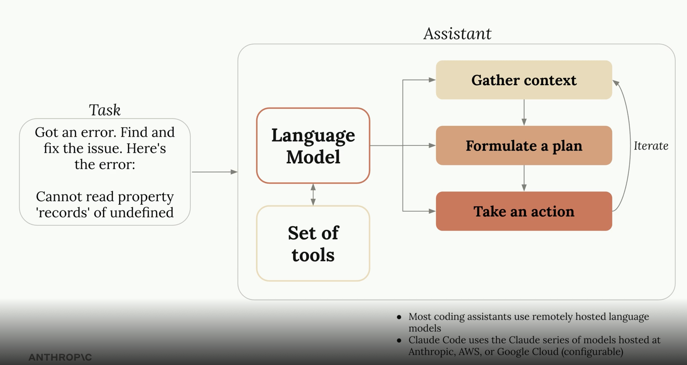
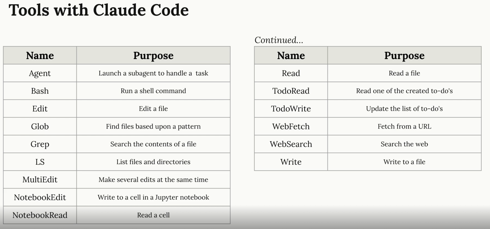

*Notes from Anthropic's [Claude Code in Action](https://anthropic.skilljar.com/claude-code-in-action/303241) course.*

---

## What Is a Coding Assistant?

A coding assistant is a **tool** — it does whatever the model instructs it to do (e.g. read a file, run a command, edit code). The language model is the brain; the assistant is the hands.



The assistant loop:
1. **Gather context** — read files, search code, understand the codebase
2. **Formulate a plan** — decide what steps are needed
3. **Take an action** — execute via tools, observe the result, iterate

> Most coding assistants use remotely hosted language models. Claude Code uses the Claude series of models hosted at Anthropic, AWS, or Google Cloud (configurable).

---

## How Tools Work

Models are given **plain text descriptions** of what each tool does — e.g. `ReadFile: main.go`. The model decides which tool to call and when, based solely on those descriptions. Claude's models are particularly good at interpreting tool descriptions and chaining calls to complete multi-step tasks. The tool set is extensible — new tools can be added as needed (via MCP).

**Tool call lifecycle:**

```
User prompt
    │
    ▼
Model reasons → selects tool + arguments
    │
    ▼
Tool executes in the environment
    │
    ▼
Result returned to model's context
    │
    ▼
Model reasons again → next tool call or final response
```

---

## Tools Available in Claude Code



| Tool | Purpose |
|------|---------|
| **Agent** | Launch a subagent to handle a subtask in parallel or isolation |
| **Bash** | Run a shell command |
| **Edit** | Make targeted edits to an existing file |
| **MultiEdit** | Make several edits to a file in one call |
| **Write** | Write (or overwrite) a file |
| **Read** | Read a file |
| **Glob** | Find files matching a pattern |
| **Grep** | Search file contents |
| **LS** | List files and directories |
| **NotebookRead** | Read a Jupyter notebook cell |
| **NotebookEdit** | Write to a Jupyter notebook cell |
| **WebFetch** | Fetch content from a URL |
| **WebSearch** | Search the web |
| **TodoRead** | Read the agent's to-do list |
| **TodoWrite** | Update the agent's to-do list |

Tools are grouped by what they touch:

| Category | Tools |
|----------|-------|
| File system | Read, Write, Edit, MultiEdit, Glob, Grep, LS |
| Execution | Bash |
| Web | WebFetch, WebSearch |
| Orchestration | Agent, TodoRead, TodoWrite |
| Notebooks | NotebookRead, NotebookEdit |

---

## Giving Claude Code Project Context

Claude Code looks for a **`CLAUDE.md`** file at the root of your project. This file is always loaded into context and is the primary way to give the model persistent, project-specific knowledge.

**What to put in `CLAUDE.md`:**

```markdown
## Commands
# How to build, test, lint, run the project

## Architecture
# Key directories, design decisions, conventions

## Conventions
# Naming rules, code style, patterns to follow or avoid
```

> Think of `CLAUDE.md` as onboarding docs written for the model, not for humans. Be specific about what the model should and shouldn't do.

**Additional context mechanisms:**

| Mechanism | Scope | Purpose |
|-----------|-------|---------|
| `CLAUDE.md` (project root) | Project-wide | Architecture, commands, conventions |
| `CLAUDE.md` (subdirectory) | Subtree | Module-specific rules |
| `~/.claude/CLAUDE.md` | Global | Personal preferences across all projects |
| Memory files | Persistent | Facts remembered across sessions |

---

## Permissions & Safety

Claude Code uses a **permission model** to control what tools can run without prompting:

- **Auto-approved** — read-only operations (Read, Glob, Grep, LS) are typically allowed by default
- **Prompt-required** — writes, shell commands, and web requests require approval unless explicitly allowed
- **`settings.json`** — configure per-project or global allowlists to reduce friction on trusted operations

```json
{
  "permissions": {
    "allow": [
      "Bash(npm run *)",
      "Bash(git diff*)",
      "Edit"
    ]
  }
}
```

> The permission model exists because coding assistants take real actions with real consequences — deleting files, pushing code, sending requests. Trust is granted explicitly, not assumed.

---

## Extending Claude Code

Claude Code is designed to be extended through three mechanisms that compose cleanly together:

| Extension | What It Adds |
|-----------|-------------|
| **MCP Servers** | New tools connected to external APIs, databases, or services |
| **Skills** | Packaged workflows the agent can load and execute on demand |
| **Subagents** | Parallel agent instances for isolated or concurrent subtasks |

**Example — a code review workflow:**

```
User: "Review this PR"
  │
  ├── Subagent A → reads changed files, checks logic
  ├── Subagent B → checks tests and coverage
  └── MCP (GitHub) → posts review comments via API
```

---

## Slash Commands & Shortcuts

Claude Code supports `/commands` as shortcuts for common workflows. These can be built-in or custom:

| Command | Purpose |
|---------|---------|
| `/help` | List available commands |
| `/clear` | Clear conversation context |
| `/compact` | Summarize and compress context to free up tokens |
| `/memory` | View or edit persistent memory |
| `/config` | View or change settings |
| Custom (`/my-command`) | Run a custom workflow defined in `.claude/commands/` |

---

## Key Takeaways

| Concept | Key Idea |
|---------|---------|
| **Coding assistant** | LLM as brain, tools as hands — loops through context → plan → act |
| **Tool system** | Plain text descriptions; model decides what to call and when |
| **`CLAUDE.md`** | Always-loaded project context — architecture, conventions, commands |
| **Permission model** | Explicit allowlists control what runs without prompting |
| **MCP** | Extends the tool set with external services without modifying the agent |
| **Skills** | Packaged reusable workflows loaded on demand |
| **Subagents** | Parallel isolation — delegate subtasks to fresh agent instances |

---

*Course: [Claude Code in Action](https://anthropic.skilljar.com/claude-code-in-action/303241) — Anthropic*
